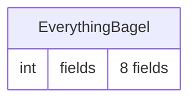

# Solution Analysis: EverythingBagel

*Generated: 2026-10-21T20:29:40.161690+00:00*

## Overview

| Metric | Count |
|--------|-------|
| Base Tables | 1 |
| Fields | 8 |
| Table Occurrences | 3 |
| Relationships | 1 |
| Scripts | 4 |
| Layouts | 2 |
| Custom Functions | 0 |
| Value Lists | 2 |

*Optional extensions not installed: networkx, pandas, matplotlib, jinja2. Install via `pip3 install -r .cursor/skills/solution-analysis/assets/requirements-analyze.txt` for deeper analysis.*

## Data Model

### Base Tables

| Table | Fields | PK | FKs | Primary Types |
|-------|--------|----|-----|---------------|
| EverythingBagel | 8 | No | 0 | Number: 3, Text: 1, Date: 1 |

### Relationship Graph Topology

- **Pattern:** flat
- **Confidence:** 0.8
- **Avg degree:** 1.0
- **Max degree:** 1
- **Hub TOs (degree >= 5):** 0

### Relationships

- **Total:** 1
- **Join types:** Equal: 1
- **Cascade create:** 0
- **Cascade delete:** 0
- **Multi-predicate joins:** 0
- **Self-joins:** 1

### Entity Relationship Diagram

## Naming Conventions

- **Dominant case style:** camelCase

## Business Logic

- **Total scripts:** 4
- **Scripts analyzed:** 4
- **Call graph edges:** 2
- **Total lines:** 329
- **Avg lines/script:** 82.2
- **Max lines:** 207

### Script Folders

| Folder | Scripts |
|--------|---------|
| (root) | 4 |

### Entry Point Scripts

Scripts not called by any other script (likely triggered by UI):

- Explode XML
- OneOfEverything

### Functional Clusters

- **(root)** — 4 scripts
  - Entry points: Explode XML, OneOfEverything

### Largest Scripts

| Script | Lines |
|--------|-------|
| OneOfEverything | 207 |
| Explode XML | 94 |
| Get agentic-fm path | 27 |
| Just Beep | 1 |

## Custom Functions

- **Total:** 0
- **Constants:** 0
- **Functional:** 0
- **Solution-specific:** 0
- **Utility:** 0

## UI Layer

- **Total layouts:** 2
- **Orphaned layouts:** 2
- **Layout summaries available:** No

### Layout Classification

| Type | Count |
|------|-------|
| navigation | 1 |
| other | 1 |

### Layouts by Base Table

| Base TO | Layouts |
|---------|---------|
| EverythingBagel | 2 |

### Orphaned Layouts

Layouts not referenced by any script `Go to Layout` step:

- CustomMenuSetLayout
- EverythingBagel

## Integration Points

### External Data Sources

- Empty - ID 1
- odbc_test - ID 2

### Value Lists

- **Total:** 2
- **Custom:** 1
- **FromField:** 1

### External Script Calls

- **Insert from URL:** 2 occurrence(s)
  - Explode XML
  - OneOfEverything
- **Send Mail:** 1 occurrence(s)
  - OneOfEverything
- **Export Records:** 1 occurrence(s)
  - OneOfEverything
- **Import Records:** 1 occurrence(s)
  - OneOfEverything

## Multi-File Architecture

**Pattern:** Multi-File

| File | Role | Local Tables | TOs (Local / External) |
|------|------|-------------|------------------------|
| EverythingBagel | Primary | 1 | 2 / 1 |

**EverythingBagel (local):** EverythingBagel

### External Data Sources

| Name | Type | Path |
|------|------|------|
| Empty | FileMaker | `file:Empty
fmnet:/127.0.0.1/Empty` |
| odbc_test | ODBC | `` |

## Health Metrics

- **Total cross-references:** 3

- **Dead fields:** 7
- **Dead scripts:** 3
- **Disconnected tables:** 0
- **Empty scripts:** 0

---
*Generated by analyze.py | 2026-10-21T20:29:40.161690+00:00*